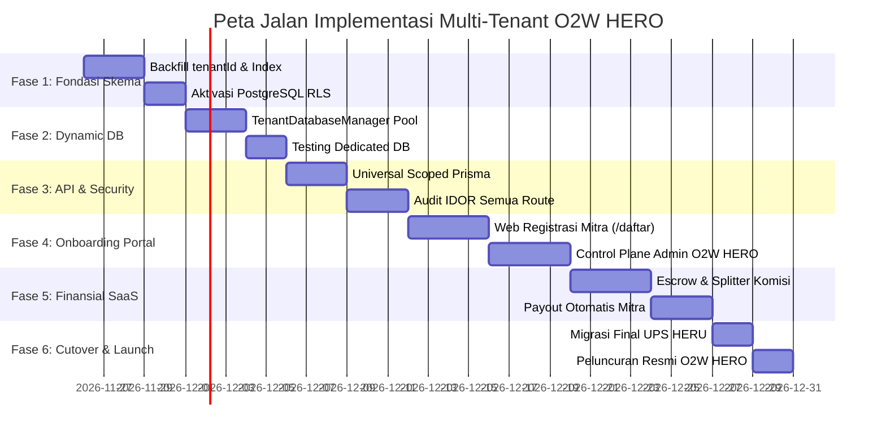

# IMPLEMENTATION_ROADMAP.md: Peta Jalan Implementasi Bertahap O2W HERO
> **Inisiatif**: Transformasi Multi-Tenant SaaS O2W HERO  
> **Pilot Tenant**: UPS HERU Kota Depok  
> **Prinsip**: Claude Fable 5.2 Disciplined Engineering & Zero Downtime  
> **Status**: Disetujui (Rencana Kerja Resmi)

---

## 1. Ikhtisar Garis Waktu & Milestone Eksekusi

Transformasi WastePay single-tenant menuju O2W HERO Multi-Tenant SaaS terbagi dalam **6 Fase Berurutan**:

---

## 2. Rincian Pekerjaan per Fase

### Fase 1: Fondasi Skema Basis Data & Keamanan (Hari 1 – Hari 5)
*Tujuan: Menjamin seluruh entitas data memiliki keterikatan tenant yang sah tanpa mengunci tabel produksi.*
- [ ] Tambahkan kolom `tenantId` pada model `Tagihan` dan `DuitkuTransaction` di `prisma/schema.prisma`.
- [ ] Tambahkan indeks gabungan `@@index([tenantId, status, periode])` pada `Tagihan`.
- [ ] Ubah unique constraint nomor pelanggan menjadi composite: `@@unique([tenantId, nomorPelanggan])`.
- [ ] Jalankan skrip DDL migrasi non-blocking di PostgreSQL server.
- [ ] Jalankan skrip backfill: hubungkan seluruh baris data historis yang belum ber-tenant ke `tenant-pilot-upsheru`.
- [ ] Konfigurasikan dan uji coba PostgreSQL Row-Level Security (RLS) di staging.

### Fase 2: Dynamic Database Router / Hybrid Manager (Hari 6 – Hari 10)
*Tujuan: Memungkinkan sistem melayani tenant standar di Shared DB dan tenant Enterprise di Dedicated DB.*
- [ ] Sempurnakan modul [src/lib/tenant/db-manager.ts](file:///data/data/com.termux/files/home/wastepay/src/lib/tenant/db-manager.ts) untuk mengelola pool koneksi Prisma secara dinamis.
- [ ] Implementasikan enkripsi kredensial koneksi database enterprise di `Tenant.dbConnectionString`.
- [ ] Uji coba isolasi read/write antara tenant uji coba di Shared DB vs tenant uji coba di Dedicated PostgreSQL container.

### Fase 3: Penegakan Universal Scoped Prisma & Validasi API (Hari 11 – Hari 16)
*Tujuan: Memastikan nol kemungkinan kebocoran data antar tenant (IDOR prevention).*
- [ ] Terapkan `createTenantScopedPrisma` sebagai wrapper default di `src/lib/prisma.ts`.
- [ ] Audit dan perbaiki seluruh endpoint `src/app/api/` (khususnya laporan cetak, komplain, dan mutasi kasir) agar mematuhi `assertTenantOwnership`.
- [ ] Perbaiki webhook WhatsApp (`/api/publik/wa-webhook`) agar memvalidasi nomor penerima bot untuk mengidentifikasi tenant pemilik sesi.
- [ ] Perbaiki webhook pembayaran Duitku (`/api/publik/duitku/notification`) untuk memetakan invoice transaksi ke kas mitra terkait.

### Fase 4: Portal Registrasi Mitra & SaaS Control Plane (Hari 17 – Hari 24)
*Tujuan: Memberikan pintu masuk digital bagi calon mitra baru dan dashboard pengelola O2W HERO.*
- [ ] Bangun halaman landing page & formulir registrasi mandiri calon mitra: `/daftar` atau `o2whero.com/mitra`.
- [ ] Bangun alur penerimaan mitra:
  1. *Step 1*: Pengisian profil TPS3R/Bank Sampah & estimasi jumlah KK.
  2. *Step 2*: Otomatisasi pembentukan subdomain uji coba (`[slug].o2whero.com`) dan akun admin percontohan.
  3. *Step 3*: Antrean verifikasi KYC oleh Superadmin di dashboard `/admin/tenants`.
- [ ] Bangun fitur aktivasi Custom Domain (pemeriksaan DNS CNAME otomatis dan verifikasi SSL Let's Encrypt).

### Fase 5: Financial Engine, Bagi Hasil & Penagihan SaaS (Hari 25 – Hari 31)
*Tujuan: Mengotomatisasi monetisasi platform O2W HERO dan transparansi bagi hasil mitra.*
- [ ] Integrasikan `TenantPaymentConfig`: memungkinkan mitra menggunakan kredensial QRIS Duitku/Midtrans sendiri atau menggunakan rekening penampung O2W HERO.
- [ ] Implementasikan `TenantLedger` untuk mencatat pembagian komisi platform (misal Rp 1.500 per transaksi) dan saldo bersih mitra.
- [ ] Bangun fitur permintaan pencairan dana kas mitra (`TenantPayout`) dengan verifikasi rekening bank.
- [ ] Implementasikan penagihan langganan SaaS otomatis (`TenantSubscription`) dengan pengingat WhatsApp bot jika masa berlaku paket habis.

### Fase 6: Cutover Pilot UPS HERU & Peluncuran Resmi (Hari 32 – Hari 35)
*Tujuan: Validasi live operasional pada pilot tenant dan pembukaan gerbang publik O2W HERO.*
- [ ] Eksekusi verifikasi akhir seluruh data operasional UPS HERU (Pelanggan, Tagihan, Supir, Truk, Kas).
- [ ] Konfirmasi fungsionalitas portal `upsheru.com` (Cek Tagihan Warga, Bayar QRIS, Absen Petugas di HP).
- [ ] Uji coba simulasi pendaftaran mitra ke-2 (Bank Sampah uji coba) untuk memvalidasi pemisahan data 100%.
- [ ] Rilis resmi O2W HERO Multi-Tenant SaaS ke publik dan media sosial.

---

## 3. Matriks Manajemen Risiko & Rencana Kontingensi

| Risiko Teridentifikasi | Kemungkinan | Dampak | Rencana Pencegahan & Mitigasi |
|---|:---:|:---:|---|
| **Query N+1 pada Tagihan** | Sedang | Tinggi | Menambahkan kolom `tenantId` langsung pada tabel `Tagihan` dan indeks gabungan `(tenantId, status, periode)`. |
| **Batas Memori Koneksi DB** | Sedang | Tinggi | Menerapkan `connection_limit` yang ketat di Prisma pool dan menggunakan PgBouncer untuk pooling koneksi. |
| **Kegagalan SSL Custom Domain** | Rendah | Tinggi | Menggunakan integrasi Cloudflare for SaaS (SSL for SaaS) untuk otomatisasi penerbitan sertifikat SSL custom domain tanpa reload Nginx. |
| **Keterlambatan Pembayaran Mitra** | Tinggi | Sedang | Sistem Grace Period (Masa Tenggang 7 Hari) sebelum portal mitra dialihkan ke status `masa_percobaan` atau `suspend`. Data warga tetap aman dan tidak dihapus. |
| **Beban CPU saat WhatsApp Blast** | Tinggi | Sedang | Menggunakan antrean background (Job Queue) dengan jeda acak 3-7 detik per pesan agar nomor WhatsApp bot mitra tidak terblokir. |

---

## 4. Definisi Sukses (Definition of Done)

Proyek transformasi dinyatakan selesai dan sukses apabila memenuhi kriteria berikut:
1. **Zero Data Loss**: 100% data historis UPS HERU terverifikasi utuh di `tenant-pilot-upsheru`.
2. **Zero Cross-Leakage**: Seluruh pengujian penetrasi IDOR dan manipulasi header host menghasilkan penolakan aman (HTTP 403 / 421).
3. **Multi-Domain Aktif**: Portal `upsheru.com` dan subdomain `[mitra].o2whero.com` melayani halaman publik dan kasir masing-masing secara independen.
4. **Automated Splitter**: Pembayaran QRIS warga otomatis memotong platform fee O2W HERO dan membukukan saldo bersih ke kas mitra tanpa rekonsiliasi manual.
