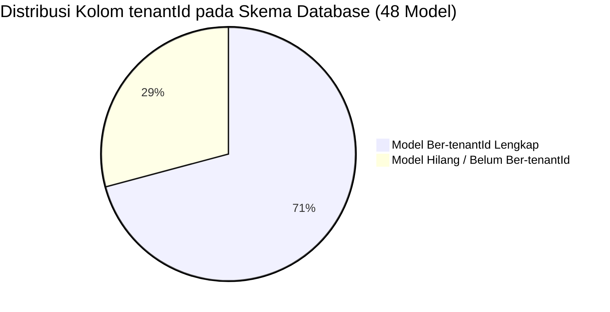
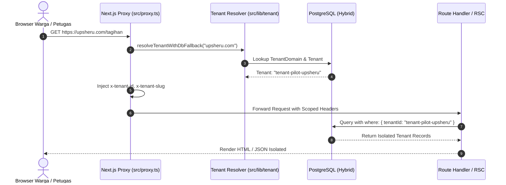

# MULTITENANT_AUDIT.md: Audit Komprehensif Arsitektur Multi-Tenant O2W HERO
> **Proyek**: O2W HERO / WastePay Core  
> **Pilot Tenant**: UPS HERU Kota Depok  
> **Peran**: Principal SaaS Architect, Database Architect, & Security Engineer  
> **Status**: Selesai Audit & Verifikasi Lapangan (Non-Destructive)

---

## 1. Ringkasan Eksekutif & Status Codebase

Transformasi dari aplikasi single-tenant **WastePay** (yang semula dirancang khusus untuk operasional pengangkutan sampah UPS HERU) menuju platform **O2W HERO Multi-Tenant SaaS** telah dimulai pada lapisan skema Prisma, middleware, dan modul kontrol domain. Namun, audit sistematis terhadap 48 model basis data, puluhan endpoint API, dan alur integrasi eksternal menemukan sejumlah area kritis yang memerlukan standarisasi menyeluruh sebelum platform dibuka untuk multi-tenant publik.

### Temuan Utama:
1. **Lapisan Database (Prisma)**:
   - 34 model inti operasional telah memiliki kolom `tenantId` (e.g. `User`, `Pelanggan`, `Petugas`, `Kendaraan`, `Pembayaran`, `Pengangkutan`).
   - **Kritis**: Model `Tagihan` dan `DuitkuTransaction` **belum memiliki kolom `tenantId` langsung**. `Tagihan` saat ini hanya mengandalkan relasi tidak langsung via `pelanggan.tenantId`. Ini memicu celah performa N+1 query dan risiko kebocoran data jika query filter `where.pelanggan.tenantId` terlewat.
   - Tabel e-commerce/marketplace (`Product`, `Cart`, `Order`, `Payment`) belum ber-tenantId.
2. **Lapisan Routing & Proxy (`src/proxy.ts`)**:
   - Telah mengimplementasikan `resolveTenantByHost` dan `resolveTenantWithDbFallback` untuk mendeteksi host/subdomain.
   - `o2whero.com` ditetapkan sebagai SaaS Control Plane (`isCore: true`), dan `upsheru.com` dipetakan ke `tenant-pilot-upsheru`.
3. **Lapisan API Handlers**:
   - Sebagian endpoint (`src/app/api/pelanggan/route.ts`) telah memvalidasi `tenantCtx`. Namun, beberapa endpoint laporan dan cetak (`/api/laporan/export`, `/api/tagihan/[id]/check-gateway`) masih membaca parameter client secara bebas tanpa validasi kepemilikan tenant (risiko IDOR).
4. **Integrasi Eksternal (WhatsApp & Payment Gateway)**:
   - Webhook WhatsApp (`/api/publik/wa-webhook`) dan Webhook Duitku (`/api/publik/duitku/notification`) membutuhkan resolusi tenant yang deterministik berbasis nomor tujuan WhatsApp dan merchant code / invoice prefix.

---

## 2. Audit Model Basis Data (Prisma Schema)

### A. Model Control Plane SaaS (10 Model)
Model-model ini mengelola ekosistem multi-tenant, registrasi mitra, kuota, dan langganan O2W HERO:
- [x] `Tenant` (`id`, `slug`, `namaMitra`, `status`, `paketLangganan`, `dbConnectionString`, `customDomain`, `subdomain`) [schema.prisma#L1093-L1171](file:///data/data/com.termux/files/home/wastepay/prisma/schema.prisma#L1093-L1171)
- [x] `TenantDomain` (Multi-domain & SSL mapping per mitra) [schema.prisma#L1173-L1186](file:///data/data/com.termux/files/home/wastepay/prisma/schema.prisma#L1173-L1186)
- [x] `MitraRegistration` (Pipeline registrasi & KYC onboarding) [schema.prisma#L1188-L1200](file:///data/data/com.termux/files/home/wastepay/prisma/schema.prisma#L1188-L1200)
- [x] `TenantWhatsAppConfig` (Kredensial WhatsApp gateway per tenant) [schema.prisma#L1213-L1245](file:///data/data/com.termux/files/home/wastepay/prisma/schema.prisma#L1213-L1245)
- [x] `TenantQuotaUsage` (Penghitungan kuota warga, WA blast, API call) [schema.prisma#L1247-L1274](file:///data/data/com.termux/files/home/wastepay/prisma/schema.prisma#L1247-L1274)
- [x] `TenantPaymentConfig` (Kredensial Midtrans/Duitku/QRIS per tenant) [schema.prisma#L1276-L1313](file:///data/data/com.termux/files/home/wastepay/prisma/schema.prisma#L1276-L1313)
- [x] `TenantLedger` & `TenantPayout` (Bagi hasil komisi platform & pencairan dana mitra) [schema.prisma#L1315-L1357](file:///data/data/com.termux/files/home/wastepay/prisma/schema.prisma#L1315-L1357)
- [x] `TenantMembership` (Multi-tenant user switching) [schema.prisma#L1359-L1373](file:///data/data/com.termux/files/home/wastepay/prisma/schema.prisma#L1359-L1373)
- [x] `TenantSubscription` (SaaS billing & tier langganan) [schema.prisma#L1375-L1393](file:///data/data/com.termux/files/home/wastepay/prisma/schema.prisma#L1375-L1393)

### B. Model Operasional Ber-tenantId Lengkap (34 Model)
Tabel-tabel ini telah memiliki kolom `tenantId String?` dan terhubung relasional ke `Tenant`:
- **Akun & Profil**: `User`, `Petugas`, `Pelanggan`
- **Operasional Armada & GIS**: `Kendaraan`, `LokasiKendaraan`, `LokasiPetugas`, `TitikTransit`, `Rute`, `Jadwal`, `Pengangkutan`, `Tpa`
- **Finansial & Kasir**: `Pembayaran`, `Pengeluaran`, `Rekonsiliasi`, `KlaimPetugas`
- **Pelayanan Warga & Notifikasi**: `Komplain`, `LiburSementara`, `Pengumuman`, `AuditLog`, `Notifikasi`, `ChatPesan`
- **Area & Wilayah Operasi**: `Wilayah`, `Zona`, `ZonaPetugas`, `KategoriTarif`, `Paket`, `Absensi`, `Pengaturan`
- **Layanan Tambahan**: `Artikel`, `Produk`, `MarketplaceOrder`, `MarketplaceOrderItem`, `KategoriPickup`, `PesananPickup`

### C. Model yang BELUM Memiliki tenantId (14 Model) — **Area Rawan**
1. **`Tagihan` (Sangat Kritis)**:
   - *Lokasi*: [schema.prisma#L372-L399](file:///data/data/com.termux/files/home/wastepay/prisma/schema.prisma#L372-L399)
   - *Masalah*: Hanya memiliki `pelangganId`. Query tagihan harus selalu melakukan `include: { pelanggan: true }` untuk mengetahui pemilik tenant. Jika ada query langsung `prisma.tagihan.findMany({ where: { status: 'belum_bayar' } })`, data tagihan seluruh tenant akan tercampur.
   - *Rekomendasi*: Tambahkan `tenantId String?` langsung pada model `Tagihan` dengan indeks gabungan `@@index([tenantId, status, periode])`.
2. **`DuitkuTransaction` (Kritis)**:
   - *Lokasi*: [schema.prisma#L1064-L1089](file:///data/data/com.termux/files/home/wastepay/prisma/schema.prisma#L1064-L1089)
   - *Masalah*: Transaksi gateway pembayaran pihak ketiga tidak memiliki `tenantId`. Callback notifikasi dari Duitku kesulitan memetakan transaksi ke kas mitra terkait tanpa lookup nomor invoice.
3. **`Kelurahan` (Master Data Global - Desain Sah)**:
   - *Lokasi*: [schema.prisma#L50-L65](file:///data/data/com.termux/files/home/wastepay/prisma/schema.prisma#L50-L65)
   - *Status*: Data geografis master (Kemendagri/BPS) memang bersifat global/shared reference data. Tidak memerlukan `tenantId`.
4. **Model Toko & E-Commerce Limbah**:
   - `SellerProfile`, `Category`, `Product`, `ProductImage`, `Cart`, `CartItem`, `Order`, `SellerOrder`, `OrderItem`, `Payment`, `Shipment`.
   - *Status*: Saat ini belum ber-tenantId. Perlu dimasukkan `tenantId` jika marketplace bersifat multi-tenant (setiap mitra memiliki etalase lokal masing-masing).

---

## 3. Audit Alur Autentikasi & Resolusi Domain

### Analisis Evaluasi:
1. **Resolusi Hostname**:
   - `src/lib/tenant/server-resolver.ts` menangani pemetaan domain utama (`o2whero.com` -> `isCore: true`), subdomain (`upsheru.o2whero.com`), dan custom domain (`upsheru.com`).
   - **Potensi Celah**: Caching domain DNS/Tenant di memori server Next.js harus memiliki mekanisme invalidasi TTL (Time-To-Live). Jika admin O2W HERO menonaktifkan status tenant (`status = "suspend"`), proxy harus segera menolak request tanpa harus restart aplikasi.
2. **Autentikasi Pengguna & Token Versioning**:
   - Token JWT memuat `payload.tenantId` dan `payload.v` (token version).
   - [src/proxy.ts#L400-L434](file:///data/data/com.termux/files/home/wastepay/src/proxy.ts#L400-L434): Memverifikasi keaktifan akun dan kecocokan tokenVersion terhadap basis data.
   - **Perlindungan Terverifikasi**: Jika staf dipindahkan tenant atau di-nonaktifkan, perubahan `tokenVersion` secara instan membatalkan seluruh sesi login di perangkat mobile/web.

---

## 4. Audit Titik Kebocoran Data Antar Tenant (Cross-Tenant Leakage)

| Vektor Serangan / Celah | Lokasi Kode | Tingkat Risiko | Status Saat Ini | Rencana Mitigasi |
|---|---|:---:|---|---|
| **IDOR pada Tagihan Publik** | `src/app/api/publik/tagihan-detail/route.ts` | **TINGGI** | Lookup nomor pelanggan atau noInvoice tanpa validasi kecocokan `tenantId` domain aktif. | Suntikkan `tenantId` dari host domain ke klausa `where`. |
| **Penyusupan IDOR Cetak Laporan** | `src/app/(admin)/laporan-pembayaran-cetak` | **SEDANG** | Kasir tenant A berpotensi mengakses parameter ID pembayaran tenant B. | Gunakan `assertTenantOwnership(record, session.tenantId)`. |
| **Ambiguitas Webhook WhatsApp** | `src/app/api/publik/wa-webhook/route.ts` | **TINGGI** | Pesan masuk dari nomor warga dicocokkan global ke nomor telepon tanpa memfilter bot mana yang menerima. | Ekstrak nomor pengirim dan nomor penerima (device ID) untuk mengunci tenant pemilik sesi bot. |
| **Kueri Agregasi Keuangan** | `src/app/api/dashboard/route.ts` | **TINGGI** | `prisma.pembayaran.aggregate` tanpa `where.tenantId`. | Wajib gunakan `createTenantScopedPrisma` atau klausa `where.tenantId`. |
| **AI Command Hub Multi-Tenant** | `src/app/api/ai-command/route.ts` | **KRITIS** | Tool execution AI yang dijalankan superadmin vs tenant admin. | Prompt injection filter: AI dilarang menghasilkan query lintas `tenantId`. |

---

## 5. Kesimpulan Audit & Rekomendasi Aksi Cepat

1. **Prioritas P0 (Skema Database)**:
   - Migrasikan kolom `tenantId` ke tabel `Tagihan` dan `DuitkuTransaction`.
   - Tambahkan composite unique index `@@unique([tenantId, nomorPelanggan])` pada `Pelanggan` agar nomor pelanggan unik di tingkat mitra, bukan bentrok global.
2. **Prioritas P1 (Prisma Middleware / Client Extension)**:
   - Terapkan `createTenantScopedPrisma` secara universal di `src/lib/prisma.ts` sehingga seluruh query `findMany`, `findFirst`, `update`, `delete` otomatis terisolasi secara default tanpa mengandalkan ketelitian programmer menulis `where: { tenantId }`.
3. **Prioritas P2 (Control Plane Separation)**:
   - Pisahkan dashboard operasional TPS3R dengan dashboard platform SaaS O2W HERO.
