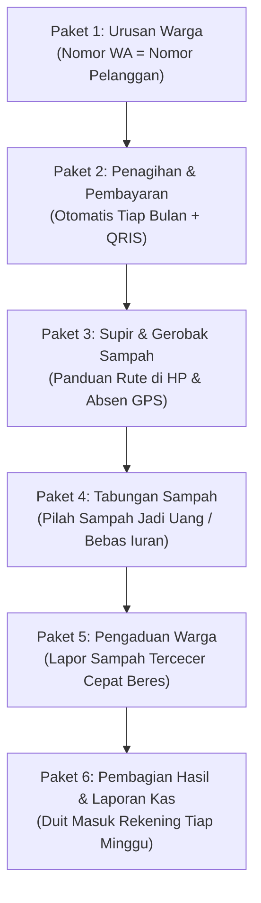

# Panduan Lengkap & Penjelasan Fitur O2W HERO
## Sistem Aplikasi Pengelolaan Sampah & Daur Ulang Terpadu

Dokumen ini menjelaskan seluruh alur kerja dan fitur **O2W HERO** menggunakan bahasa Indonesia yang **sederhana, jelas, dan mudah dipahami** oleh siapa saja—baik pemilik usaha sampah, pengurus RT/RW, petugas lapangan, maupun masyarakat umum.

---

## 🌟 Apa Itu O2W HERO?

**O2W HERO** adalah aplikasi pintar untuk membantu tempat pengolahan sampah (**TPS3R**, **Bank Sampah**, **Pengangkut Swasta**, maupun **Dinas Lingkungan Hidup**) agar operasional penarikan sampah, penagihan iuran warga, dan tabungan sampah daur ulang menjadi **serba otomatis, rapi, dan transparan**.

Dalam sistem ini, ada **4 pihak yang saling terhubung**:
1. **Pengelola Pusat (O2W HERO)**: Penyedia sistem aplikasi dan pembayaran online.
2. **Mitra / Unit Pengelola (seperti UPS HERU, Bank Sampah Berkah, TPS3R Kelurahan)**: Badan yang mengelola operasional sampah di wilayahnya masing-masing dengan website mereka sendiri (contoh: `upsheru.com`).
3. **Petugas Lapangan (Supir Truk, Penarik Gerobak Motor / Cator, dan Petugas Tagih)**: Tim yang bertugas keliling mengangkut sampah warga setiap hari.
4. **Warga / Nasabah (Rumah Tangga, Warung, Toko, Kost)**: Warga yang sampahnya diangkut rutin dan membayar iuran tiap bulan.

---

## 💡 Rombakan 6 Paket Fitur Utama O2W HERO

Berikut adalah pembagian fitur O2W HERO yang sudah disederhanakan agar langsung tepat sasaran untuk kebutuhan lapangan:

---

### Paket 1: Urusan Warga Jadi Super Gampang (Cukup Pakai Nomor WhatsApp)

*Masalah Lapangan Lama:* Warga sering lupa nomor pelanggan atau kartu tagihan hilang, sehingga petugas kasir kesulitan mencari data.

*Solusi O2W HERO:*
1. **Nomor WhatsApp Langsung Jadi Nomor Pelanggan**:
   - Warga tidak perlu menghafal kode aneh seperti `HRJ-2026-001`.
   - Cukup sebutkan nomor WhatsApp (contoh: `081290429898`), data rumah dan status iuran langsung terbuka.
2. **Cek Tagihan Mandiri Tanpa Ribet**:
   - Warga cukup membuka website (misal: `upsheru.com/bayar`) lalu mengetikkan nomor WhatsApp sendiri. Total tagihan bulan ini langsung muncul di layar HP.
3. **Stiker Barcode / QR di Pagar Rumah**:
   - Tiap rumah bisa ditempeli stiker barcode kecil.
   - Petugas yang lewat tinggal scan pakai kamera HP untuk cek apakah rumah tersebut sudah bayar iuran atau belum.
4. **Warga Bisa Daftar Sendiri Lewat HP**:
   - Warga baru cukup mengisi nama, nomor WA, dan alamat lewat web pendaftaran tanpa harus datang ke kantor.

---

### Paket 2: Penagihan & Pembayaran Otomatis (Bebas Ribet & Hemat Kertas)

*Masalah Lapangan Lama:* Tagihan harus dicetak di kertas satu per satu, petugas tagih harus bolak-balik menagih ke rumah, dan rawan uang setoran tercecer.

*Solusi O2W HERO:*
1. **Tagihan Otomatis Terbit Tiap Awal Bulan**:
   - Tiap tanggal 1, sistem otomatis membuatkan tagihan untuk semua warga aktif dengan batas jatuh tempo tanggal 15.
2. **Pengingat Tagihan Otomatis via WhatsApp (Bot WA)**:
   - Sistem mengirim pesan WhatsApp otomatis yang sopan ke HP warga: *"Halo Bpk/Ibu, tagihan iuran kebersihan bulan ini sebesar Rp 35.000 sudah terbit. Silakan bayar lewat link berikut..."*
3. **Bisa Bayar Pakai QRIS & Transfer Bank (Online)**:
   - Warga tinggal scan kode **QRIS** dari aplikasi perbankan apa saja (BCA, Mandiri, BRI, BNI) atau dompet digital (GoPay, OVO, DANA, ShopeePay).
   - Begitu transfer berhasil, status langsung berubah jadi **LUNAS** dalam 1 detik!
4. **Kuitansi Resmi Langsung Dikirim ke WhatsApp**:
   - Warga otomatis menerima bukti kuitansi lunas format PDF lewat WhatsApp. Tidak perlu lagi kuitansi kertas manual.
5. **Fitur Bayar Sekaligus Satu RT (Bayar Kolektif)**:
   - Untuk perumahan yang iurannya dikumpulkan oleh pengurus RT, Pak RT bisa membayar tagihan 50 rumah warganya sekaligus dalam 1 kali transfer QRIS/VA.

---

### Paket 3: Pengangkutan Sampah & Kerja Petugas Jadi Rapi

*Masalah Lapangan Lama:* Supir sering lupa rumah mana yang harus diambil hari ini, rute gerobak acak-acakan, dan supir susah mencatat bon bensin.

*Solusi O2W HERO:*
1. **Daftar Rumah Muncul di HP Petugas (Jadwal Kerja)**:
   - Supir atau penarik cator membuka menu kerja di HP (`/m/angkut`).
   - Layar menampilkan daftar jalan dan rumah yang harus diangkut hari itu (misalnya jadwal giliran hari Senin dan Kamis).
2. **Tinggal Centang Cepat**:
   - Sambil berjalan, petugas cukup klik: **"Sudah Diambil"**, **"Rumah Kosong"**, atau **"Sampah Belum Dikeluarkan"**.
3. **Catat Timbangan Sampah**:
   - Petugas bisa mencatat berapa karung atau berapa kilogram sampah yang diangkut.
   - Jika sampah dibuang ke TPA, supir bisa langsung mencatat nomor tiket timbangan TPA dan biaya retribusi truk.
4. **Absen Petugas Pakai HP (GPS)**:
   - Petugas absen masuk kerja cukup dari HP di pool/kantor. Aplikasi otomatis mendeteksi lokasi GPS agar petugas benar-benar hadir di tempat.
5. **Klaim Uang Bensin & Tambal Ban Langsung Difoto**:
   - Jika beli bensin atau tambal ban di jalan, petugas tinggal foto struknya di aplikasi. Admin kantor langsung memverifikasi dan mengganti uangnya.

---

### Paket 4: Tabungan Sampah (Sampah Daur Ulang Jadi Uang & Bebas Iuran)

*Masalah Lapangan Lama:* Warga malas memilah sampah karena tidak ada manfaat langsung, dan pencatatan tabungan sampah di buku tulis sering robek atau hilang.

*Solusi O2W HERO:*
1. **Timbang Sampah, Duit Langsung Masuk ke HP**:
   - Warga yang menyetor kardus, botol plastik, emberan, atau minyak jelantah ditimbang oleh petugas.
   - Nilai uangnya langsung masuk ke **Buku Tabungan Sampah Digital** warga.
2. **Fitur Pemotong Iuran Otomatis (Sampah Gratiskan Iuran!)**:
   - Saldo tabungan sampah bisa diatur otomatis untuk memotong tagihan iuran bulanan warga.
   - *Contoh:* Tagihan iuran Rp 35.000, tapi warga punya saldo sampah Rp 40.000 $\rightarrow$ tagihan bulan itu jadi **Rp 0 (GRATIS)** dan sisa saldonya masih tersimpan Rp 5.000!
3. **Pencairan Saldo Fleksibel**:
   - Warga bisa mencairkan saldo tabungannya menjadi uang tunai sewaktu-waktu saat acara hari raya atau kebutuhan keluarga.

---

### Paket 5: Layanan Pengaduan & Keluhan Cepat Tanggap

*Masalah Lapangan Lama:* Warga marah-marah di grup warga karena sampahnya terlewat tidak diangkut, tapi pengelola tidak tahu lokasi pastinya.

*Solusi O2W HERO:*
1. **Warga Lapor Cukup Kirim Foto**:
   - Warga membuka menu pengaduan (`/pengaduan`) atau mengirim pesan ke nomor CS WhatsApp.
   - Cukup foto tumpukan sampah dan kirim; lokasi GPS langsung terbaca oleh sistem.
2. **Peringatan ke Tim Lapangan**:
   - Kantor pengelola langsung meneruskan laporan ke armada motor sapu jagat terdekat.
3. **Laporan Selesai Lengkap dengan Bukti**:
   - Setelah dibersihkan, petugas memfoto kembali lokasi yang sudah bersih.
   - Bot WhatsApp otomatis mengirim kabar ke warga: *"Terima kasih, tumpukan sampah di depan rumah Anda sudah berhasil diangkut oleh petugas kami."*

---

### Paket 6: Pengelolaan Duit Transparan & Bagi Hasil yang Jujur

*Masalah Lapangan Lama:* Pengelola kesulitan memisahkan mana uang hak mitra, mana biaya aplikasi, dan sering tekor karena pembukuan tidak rapi.

*Solusi O2W HERO:*
1. **Buku Kas Otomatis Tiap Hari**:
   - Semua uang masuk dari iuran warga dan uang keluar untuk operasional tercatat rapi secara otomatis.
   - Pemilik atau direksi mitra bisa melihat keuntungan bersih harian/bulanan tanpa perlu jasa akuntan mahal.
2. **Bagi Hasil Adil & Otomatis**:
   - Setiap kali warga membayar tagihan iuran lewat QRIS/Online:
     * Biaya aplikasi O2W HERO dipotong kecil secara otomatis (contoh: Rp 1.000 per tagihan lunas).
     * Uang bersih sisanya langsung masuk ke saldo kas mitra.
3. **Pencairan ke Rekening Bank Setiap Minggu**:
   - Uang yang terkumpul di saldo kas aplikasi akan ditransfer langsung ke rekening bank resmi mitra (BCA, Mandiri, BRI, BNI) setiap minggu tanpa ribet.

---

## 👥 Siapa Saja Pengguna Aplikasi Ini?

| Pengguna | Menggunakan Apa? | Apa yang Dikerjakan? |
| :--- | :--- | :--- |
| **Bos / Manajer Mitra** | Komputer / Tablet di Kantor | Melihat laporan keuangan laba-rugi, mengatur jadwal rute armada, dan mengontrol tarif iuran. |
| **Kasir Posko** | Laptop / HP Kasir | Menerima bayaran tunai dari warga, cetak kuitansi, dan menimbang sampah daur ulang nasabah. |
| **Supir & Kernet** | HP Android di Lapangan | Absen GPS, melihat daftar rumah yang harus diambil hari ini, dan mencatat bon bensin. |
| **Warga / Pelanggan** | HP Sendiri (Web / WhatsApp) | Cek tagihan mandiri dengan nomor WA, bayar lewat QRIS, dan komplain jika sampah belum diangkut. |
| **Pengelola Pusat (O2W)** | Portal Pusat (`o2whero.com`) | Mengaktifkan mitra baru, menyiapkan alamat website mitra, dan mencairkan uang mitra ke bank. |

---

## 🎯 Kesimpulan

Dengan perombakan fitur ini:
1. **Warga Senang**: Karena tidak perlu menghafal nomor aneh (cukup nomor WA), bayar gampang pakai QRIS, dan bisa gratis iuran kalau rajin nabung sampah.
2. **Petugas Tenang**: Karena kerjaan harian jelas di HP, tidak ada rumah yang terlewat, dan bensin langsung diganti.
3. **Pengelola Untung**: Karena tidak ada warga yang menunggak tanpa ketahuan, pencatatan kas rapi, dan laporan keuangan langsung beres tanpa pusing.
