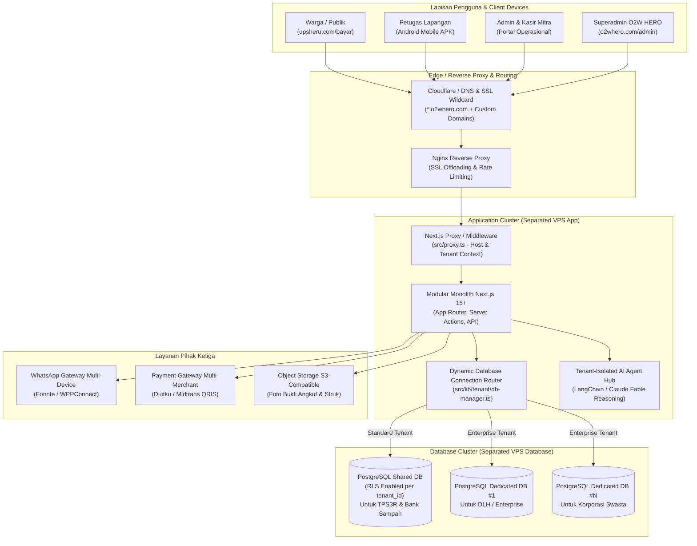
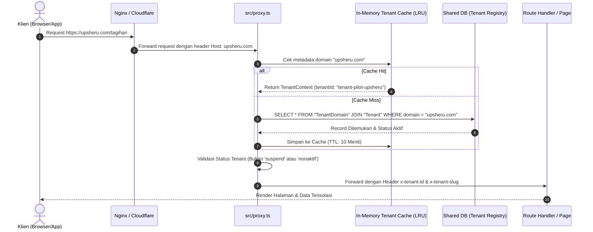
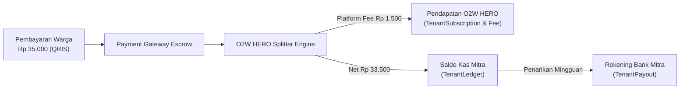

# TARGET_ARCHITECTURE.md: Arsitektur Target O2W HERO Multi-Tenant SaaS
> **Platform**: O2W HERO (Waste Ecosystem SaaS Control Plane)  
> **Pilot Tenant**: UPS HERU Kota Depok  
> **Target Pasar**: TPS3R, Bank Sampah, Pengangkut Swasta, & Dinas Lingkungan Hidup (DLH)  
> **Status**: Disetujui & Ditetapkan (Blueprint Resmi)

---

## 1. Visi Arsitektur & Keputusan Strategis

O2W HERO dirancang untuk menjadi sistem operasi cerdas (Smart Operating System) bagi seluruh ekosistem pengelolaan sampah di Indonesia. Empat keputusan strategis yang telah dikunci:

| Keputusan Strategis | Pilihan Ditetapkan | Justifikasi Teknis & Bisnis |
|---|---|---|
| **1. Strategi Basis Data** | **Hybrid Database** | Shared PostgreSQL (dengan RLS) untuk tenant standard/SMB (TPS3R, Bank Sampah), dan Dedicated PostgreSQL instance untuk Enterprise/Pemerintah (DLH). |
| **2. Strategi Infrastruktur** | **Separated Infrastructure** | Node.js/Next.js Application Server berada di VPS/Cloud terpisah dari Database Server (PostgreSQL Cluster) untuk stabilitas I/O dan keamanan data. |
| **3. Strategi Onboarding** | **Hybrid Onboarding** | Registrasi mandiri (*self-service*) instan dengan akun sandbox/trial, dilanjutkan verifikasi manual KYC oleh O2W HERO untuk aktivasi gateway pembayaran & custom domain. |
| **4. Target Pasar** | **All Ecosystem** | Melayani seluruh spektrum: TPS 3R, Bank Sampah, Pengepul Komersial, DLH / Pemerintah Daerah, dan Armada Swasta. |

---

## 2. Diagram Topologi Sistem (High-Level Topology)



---

## 3. Alur Resolusi Multi-Tenant (Host & Domain Resolution)

Setiap request HTTP yang masuk ke server diekstrak host header-nya oleh Next.js Proxy:



### Aturan Resolusi Host:
1. **Control Plane (`isCore: true`)**:
   - `o2whero.com`, `admin.o2whero.com`, `localhost:3000`.
   - Mengakses fitur global SaaS: Registrasi Mitra, Penagihan SaaS, Audit Log Global, Peta Persebaran Mitra.
2. **Subdomain Mitra**:
   - `[slug].o2whero.com` (contoh: `upsheru.o2whero.com`, `banksampah-berkah.o2whero.com`).
   - Menyediakan portal otomatis untuk setiap mitra yang belum memiliki domain sendiri.
3. **Custom Domain**:
   - `upsheru.com`, `banksampahberkah.id`.
   - Terhubung melalui verifikasi DNS CNAME / A-Record ke IP server O2W HERO.

---

## 4. Dynamic Database Connection Router (Hybrid Database)

Dalam arsitektur Hybrid, sebagian besar tenant berada di **Shared Database** dengan proteksi Row-Level Security (RLS). Namun ketika ada tenant berstatus Enterprise (seperti Dinas Lingkungan Hidup Kabupaten/Kota), sistem secara dinamis mengarahkan koneksi ke **Dedicated Database**.

```typescript
// Implementasi Konsep: Dynamic Tenant Prisma Pool
export class TenantDatabaseManager {
  private static pools: Map<string, PrismaClient> = new Map();

  public static async getClient(tenant: Tenant): Promise<PrismaClient> {
    // 1. Jika tenant memiliki koneksi database khusus (Dedicated DB)
    if (tenant.paketLangganan === "enterprise" && tenant.dbConnectionString) {
      if (!this.pools.has(tenant.id)) {
        const dedicatedPrisma = new PrismaClient({
          datasources: { db: { url: tenant.dbConnectionString } }
        });
        this.pools.set(tenant.id, dedicatedPrisma);
      }
      return this.pools.get(tenant.id)!;
    }

    // 2. Default: Shared Database dengan Tenant Scope
    return createTenantScopedPrisma(tenant.id, defaultSharedPrisma);
  }
}
```

---

## 5. Arsitektur Bagi Hasil & Pemisahan Pendapatan (Financial Engine)

Pemisahan tegas antara **Pendapatan Platform O2W HERO** dan **Pendapatan Operasional Mitra**:



1. **Pendapatan SaaS O2W HERO**:
   - Biaya Langganan Bulanan/Tahunan per paket (`TenantSubscription`).
   - Platform Fee per transaksi QRIS/VA (misal Rp 1.000 - Rp 1.500 per transaksi).
   - Biaya kuota tambahan (Add-on WhatsApp Blast dan AI Command Hub).
2. **Pendapatan Operasional Mitra (UPS HERU / Mitra lain)**:
   - Iuran kebersihan bulanan warga.
   - Hasil penjualan sampah daur ulang terpilah.
   - Biaya penarikan sampah insidental / borongan.
   - Tercatat secara transparan di `TenantLedger` dan dicairkan berkala via `TenantPayout`.

---

## 6. AI Multi-Agent Tenant Isolation

Fitur AI Command Hub (`src/app/(admin)/ai-command`) ditenagai oleh mesin reasoning Claude Fable 5.2 dengan isolasi ketat:

1. **Context Boundary**: Prompt sistem AI selalu di-injeksi metadata tenant aktif (`tenantId`, `namaMitra`, batas wilayah `Kelurahan`).
2. **Tool Sandboxing**: Seluruh tools eksekusi yang dipanggil oleh AI (seperti `tetapkanJadwal`, `buatTagihan`, `kirimNotifikasi`) wajib membungkus operasinya dalam `createTenantScopedPrisma(context.tenantId)`.
3. **No Cross-Tenant Memory**: Vektor database dan log memori percakapan AI dipisahkan dengan namespace ID tenant, mencegah kebocoran strategi operasional atau data warga antar mitra.
