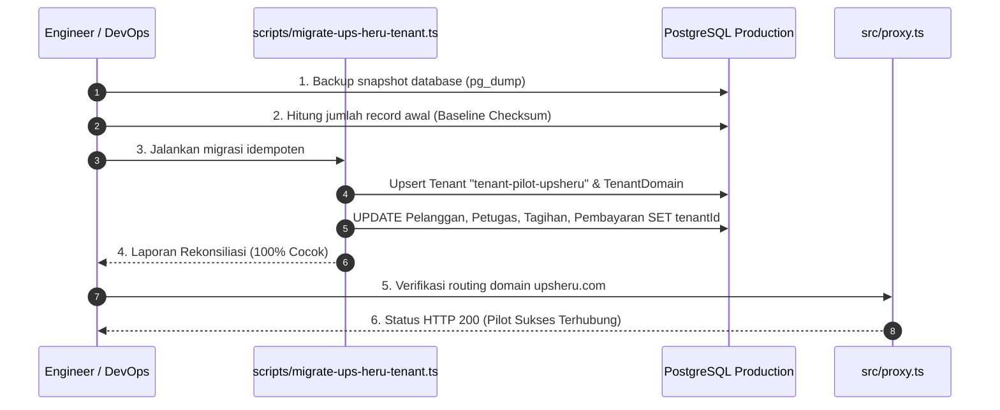

# UPS_HERU_MIGRATION_PLAN.md: Rencana Migrasi Data UPS HERU ke Tenant #1
> **Pilot Tenant**: UPS HERU Kota Depok (`tenant-pilot-upsheru`)  
> **Domain Utama**: `upsheru.com`  
> **Subdomain Cadangan**: `upsheru.o2whero.com`  
> **Jaminan Kualitas**: Nol Kehilangan Data (Zero Data Loss) & Nol Downtime (Zero Downtime)

---

## 1. Komitmen Integritas Data (Zero Data Loss Guarantee)

UPS HERU adalah bukti hidup keberhasilan operasional sistem WastePay. Dalam transisi menuju O2W HERO, data historis operasional UPS HERU **tidak boleh berkurang satu baris pun**:

- [x] **Data Pelanggan (Warga)**: Riwayat nomor pelanggan, nomor WhatsApp, alamat jalan, RT/RW, koordinat GPS pagar, dan kategori tarif wajib utuh.
- [x] **Riwayat Keuangan (Tagihan & Pembayaran)**: Seluruh invoice terbit, status lunas/belum bayar, bukti kuitansi PDF, dan mutasi kasir tidak boleh terputus.
- [x] **Akun Staf & Petugas**: Akun login pengelola, kasir, supir truk, dan kenek tetap aktif dengan kredensial password yang sama.
- [x] **Armada & Logistik**: Data nomor polisi kendaraan, rute pengangkutan, titik transit lapak, dan log absensi tetap tersambung.
- [x] **Pengaduan & Audit Log**: Riwayat komplain warga dan log forensik audit tetap terjaga.

---

## 2. Parameter Profil Tenant Pilot UPS HERU

```json
{
  "id": "tenant-pilot-upsheru",
  "slug": "upsheru",
  "namaMitra": "UPS HERU Kota Depok",
  "tipePengelola": "tps3r",
  "status": "aktif",
  "paketLangganan": "percontohan",
  "customDomain": "upsheru.com",
  "subdomain": "upsheru.o2whero.com",
  "penanggungJawab": "Pengurus UPS HERU",
  "kota": "Depok",
  "provinsi": "Jawa Barat",
  "warnaTema": "#059669",
  "fiturAktif": {
    "qrisOnline": true,
    "waBotReminder": true,
    "gpsTracking": true,
    "tabunganSampah": true,
    "bayarKolektif": true
  }
}
```

---

## 3. Runbook Pelaksanaan Migrasi Langkah demi Langkah



### Langkah 1: Snapshot Cadangan Basis Data (Pre-Migration Backup)
Sebelum menyentuh baris data produksi, buat backup snapshot lokal:
```bash
pg_dump -Fc -v --no-owner --no-acl \
  -d "$DATABASE_URL" \
  -f "/data/data/com.termux/files/home/wastepay/scratch/pre_migration_backup_$(date +%Y%m%d_%H%M%S).dump"
```

### Langkah 2: Audit Baseline Jumlah Record (Pre-Flight Counts)
Catat jumlah baris sebelum migrasi untuk verifikasi akhir:
```sql
SELECT 
  (SELECT COUNT(*) FROM "Pelanggan") as total_pelanggan,
  (SELECT COUNT(*) FROM "Tagihan") as total_tagihan,
  (SELECT COUNT(*) FROM "Pembayaran") as total_pembayaran,
  (SELECT COUNT(*) FROM "Petugas") as total_petugas,
  (SELECT COUNT(*) FROM "Kendaraan") as total_kendaraan,
  (SELECT COUNT(*) FROM "Komplain") as total_komplain;
```

### Langkah 3: Eksekusi Skrip Migrasi Idempoten
Skrip mandiri TypeScript [scripts/migrate-ups-heru-tenant.ts](file:///data/data/com.termux/files/home/wastepay/scripts/migrate-ups-heru-tenant.ts) akan mengeksekusi:

1. **Upsert Entitas Tenant**:
   Membuat record `tenant-pilot-upsheru` jika belum ada, atau memperbarui konfigurasinya jika sudah ada.
2. **Pendaftaran Domain**:
   Mendaftarkan `upsheru.com` sebagai `isPrimary: true` dan `upsheru.o2whero.com` sebagai domain cadangan di tabel `TenantDomain`.
3. **Penyambungan Seluruh Data Historis**:
   Mengaitkan seluruh baris data operasional yang belum memiliki `tenantId` ke `tenant-pilot-upsheru`:
   - `UPDATE "Pelanggan" SET "tenantId" = 'tenant-pilot-upsheru' WHERE "tenantId" IS NULL;`
   - `UPDATE "Tagihan" SET "tenantId" = 'tenant-pilot-upsheru' WHERE "tenantId" IS NULL;`
   - `UPDATE "Pembayaran" SET "tenantId" = 'tenant-pilot-upsheru' WHERE "tenantId" IS NULL;`
   - `UPDATE "Petugas" SET "tenantId" = 'tenant-pilot-upsheru' WHERE "tenantId" IS NULL;`
   - `UPDATE "User" SET "tenantId" = 'tenant-pilot-upsheru' WHERE "tenantId" IS NULL AND "role" != 'superadmin';`
   - `UPDATE "Kendaraan" SET "tenantId" = 'tenant-pilot-upsheru' WHERE "tenantId" IS NULL;`
   - `UPDATE "Pengangkutan" SET "tenantId" = 'tenant-pilot-upsheru' WHERE "tenantId" IS NULL;`
   - `UPDATE "Komplain" SET "tenantId" = 'tenant-pilot-upsheru' WHERE "tenantId" IS NULL;`
   - `UPDATE "Pengeluaran" SET "tenantId" = 'tenant-pilot-upsheru' WHERE "tenantId" IS NULL;`
   - `UPDATE "Absensi" SET "tenantId" = 'tenant-pilot-upsheru' WHERE "tenantId" IS NULL;`

---

## 4. Verifikasi Pasca-Migrasi (Post-Migration Checklist)

Lakukan pengujian integritas langsung melalui terminal dan web:

1. **Cek Tidak Ada Record Yatim (Zero Orphaned Records)**:
   ```sql
   SELECT COUNT(*) FROM "Pelanggan" WHERE "tenantId" IS NULL; -- Wajib 0
   SELECT COUNT(*) FROM "Tagihan" WHERE "tenantId" IS NULL;   -- Wajib 0
   SELECT COUNT(*) FROM "Pembayaran" WHERE "tenantId" IS NULL; -- Wajib 0
   ```
2. **Uji Resolusi Domain Pilot**:
   ```bash
   curl -sI -H "Host: upsheru.com" http://localhost:3000/bayar | grep -E "HTTP|x-tenant"
   ```
   *Hasil yang diharapkan*: `HTTP/1.1 200 OK` dan header internal `x-tenant-slug: upsheru`.
3. **Uji Login Kasir UPS HERU**:
   Login melalui `https://upsheru.com/login` menggunakan akun staf lama. Dashboard wajib menampilkan angka tagihan dan jumlah pelanggan yang persis sama seperti sebelum migrasi.

---

## 5. Rencana Kontingensi & Rollback (Rollback Procedure)

Jika terjadi kendala fatal yang tidak terduga selama jendela pemeliharaan:
1. **Rollback Cepat Aplikasi**:
   Kembalikan routing `src/proxy.ts` ke mode bypass pilot sementara (`PILOT_TENANT` fallback diaktifkan).
2. **Rollback Penuh Basis Data**:
   Restore snapshot pre-migration:
   ```bash
   pg_restore --clean --if-exists -v -d "$DATABASE_URL" "/data/data/com.termux/files/home/wastepay/scratch/pre_migration_backup_*.dump"
   ```
Operasional UPS HERU dijamin dapat kembali normal dalam waktu kurang dari 3 menit.
