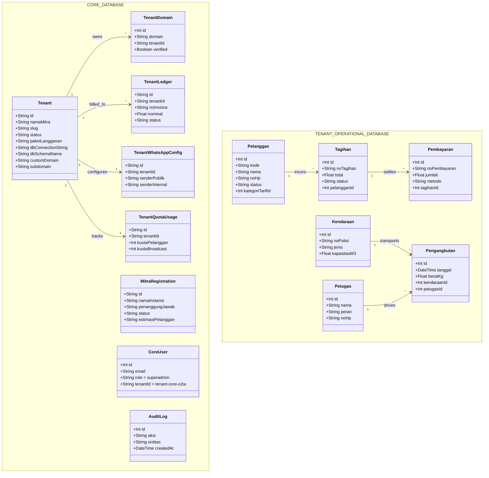

# Master Data Flow Map & Database Isolation Architecture (Phase 4)

**Project**: O2W HERO — repository `wastepay`  
**Auditor**: Senior Software Architect & Multi-Tenant SaaS Architect  
**Tanggal**: 15 November 2026  

---

## 1. Analisis Aliran Data: Page ➔ Component ➔ API ➔ Database

| Page / Modul | Data yang Ditampilkan | API Route | Service / Helper | Database Model | Tenant Scope |
|:---|:---|:---|:---|:---|:---|
| **Executive Dashboard** (`/dashboard`) | MRR, Total Mitra, Pelanggan KK, Tonase Sampah, System Health | `/api/core/control-tower` | Direct Pooler Aggregate | `Tenant`, `Pelanggan`, `Tagihan`, `Pembayaran`, `DuitkuTransaction`, `Pengangkutan` | **Cross-Tenant Aggregate (Core)** |
| **Mitra & Tenants** (`/tenants`) | Daftar mitra, kuota, connection string DB, status domain | `/api/core/tenants`, `/api/core/tenants/[id]/settings` | `dbTenantToConfig`, `registerDynamicTenant` | `Tenant`, `TenantDomain`, `TenantWhatsAppConfig`, `TenantQuotaUsage` | **Core Platform** |
| **Peta Ekosistem** (`/ecosystem-map`) | Peta sebaran TPS 3R/Bank Sampah di Indonesia | `/api/core/control-tower` | Geolocation Mapper | `Tenant`, `Pelanggan` | **Core Platform** |
| **Alert SaaS** (`/notifikasi-saas`) | Peringatan kuota tenant, broadcast logs | `/api/core/control-tower` | Quota Threshold Evaluator | `TenantQuotaUsage`, `Notifikasi` | **Core Platform** |
| **Subscriptions** (`/subscriptions`) | Paket tiering, masa aktif, ARR, renewal rate | `/api/core/control-tower` | Subscription Tier Calculator | `Tenant`, `TenantLedger` | **Core Platform** |
| **SaaS Billing** (`/saas-billing`) | Faktur piutang lisensi, bukti transfer mitra | `/api/core/billing` | Ledger Ledger Engine | `TenantLedger`, `Tenant` | **Core Platform** |
| **Revenue Intelligence** (`/revenue`) | GMV kotor, dana escrow mitra, SaaS fee bersih | `/api/core/control-tower` | Financial Reconciliation | `Pembayaran`, `DuitkuTransaction`, `Tenant` | **Core Platform** |
| **Tenant ROI** (`/tenant-roi`) | Collection rate, rasio digital, cash leakage | `/api/core/control-tower` | Performance Analytics | `Tagihan`, `Pembayaran`, `Tenant` | **Core Platform** |
| **CRM Prospek** (`/crm-prospek`) | Pipeline lead pendaftaran TPS 3R/DLH baru | `/api/core/crm` | Lead Onboarding Pipeline | `MitraRegistration` | **Core Platform** |
| **Dampak Lingkungan** (`/environmental-impact`)| Tonase sampah, daur ulang, reduksi emisi CO2 | `/api/core/control-tower` | IPCC / KLHK Waste Calculator | `Pengangkutan`, `Pelanggan` | **Core Platform** |
| **Kelola Akun Admin** (`/users`) | Akun Superadmin O2W terisolasi dari staf mitra | `/api/users` | Tenant Scoping Engine | `User`, `Tenant` | **Core Platform & Scoped Tenant** |
| **Audit Log** (`/audit-log`) | Histori mutasi data dan aksi krusial sistem | `/api/audit-log` | Audit Trail Logger | `AuditLog`, `User` | **Core Platform** |
| **Data Warga** (`/pelanggan`) | Master data KK, nomor WhatsApp, tarif, status iuran | `/api/pelanggan` | `getRequestTenantDb` | `Pelanggan`, `Wilayah`, `KategoriTarif` | **Tenant Isolated** |
| **Tagihan Iuran** (`/tagihan`) | Billing tagihan, pembayaran kasir, tunggakan | `/api/tagihan`, `/api/pembayaran` | `getRequestTenantDb` | `Tagihan`, `Pembayaran`, `DuitkuTransaction` | **Tenant Isolated** |
| **Ritase Sampah** (`/pengangkutan`) | Log berat timbang sampah, ritase truk armada | `/api/pengangkutan` | `getRequestTenantDb` | `Pengangkutan`, `Kendaraan`, `Petugas` | **Tenant Isolated** |
| **Rute & Jadwal** (`/rute`, `/jadwal`) | Pola rute jalan per kelurahan dan supir | `/api/rute`, `/api/jadwal` | `getRequestTenantDb` | `Rute`, `Jadwal`, `Petugas` | **Tenant Isolated** |

---

## 2. Pengelompokan Model Database

---

## 3. Evaluasi Kepatuhan Arsitektur Multi-Tenant

1. **Client-Side Safety**: Tidak ditemukan query Prisma langsung pada bundle browser/client. Seluruh interaksi data dilakukan melalui route handler `/api/*`.
2. **Konektivitas Pooler**: Database PostgreSQL berjalan pada dedicated connection pooler Supabase (`dedicated-pooler.sumobase.my.id:7433/postgres`).
3. **Pemisahan Sumber Data Finansial**:
   - Transaksi warga dihitung dari tabel `Pembayaran` dan `Tagihan`.
   - Fee platform SaaS dihitung berdasarkan formula komisi QRIS/VA dan tagihan lisensi di tabel `TenantLedger`.
   - Dana milik mitra dihitung sebagai saldo escrow yang siap dicairkan, sehingga tidak tercampur dengan omzet bersih O2W HERO.
4. **Kesiapan Database-per-Tenant**:
   - Modul `db-manager.ts` telah dilengkapi factory connection pool terisolasi (`createDedicatedTenantPrisma`).
   - Tenant dengan `dbConnectionString` khusus secara transparan akan membuka connection pool ke database mereka sendiri tanpa mempengaruhi Core Database.
