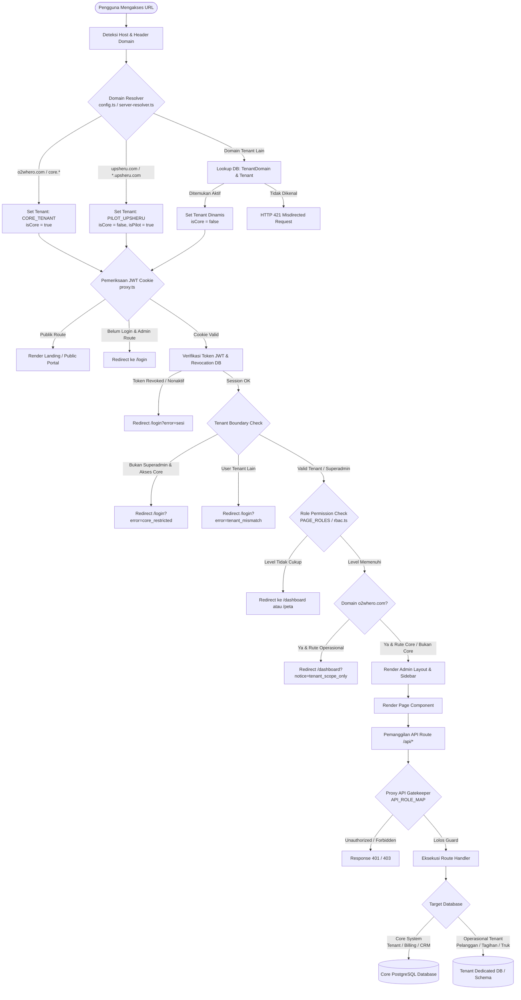
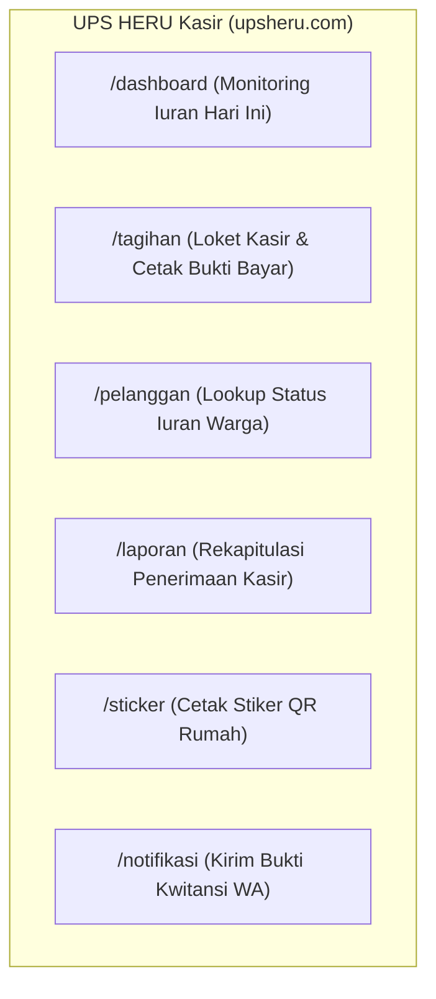
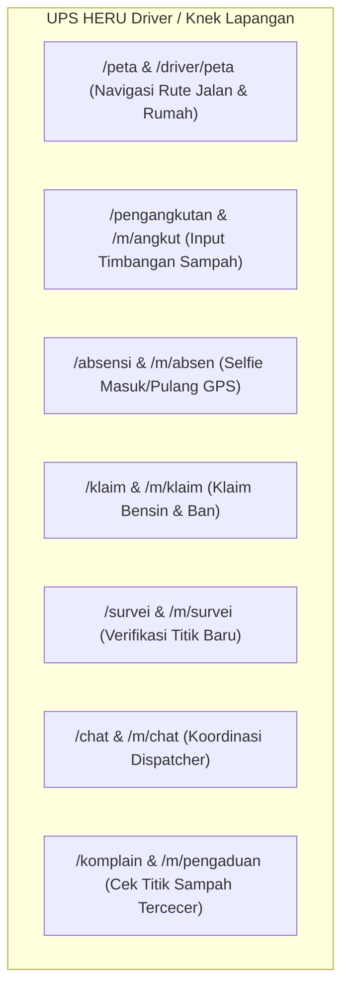

# Master Route Map & Navigation Flow Architecture (Phase 3)

**Project**: O2W HERO — repository `wastepay`  
**Auditor**: Senior Software Architect, Next.js Engineer, & Application Security Auditor  
**Tanggal**: 15 November 2026  

---

## 1. Diagram Alur Utama (End-to-End Pipeline)

Diagram berikut merepresentasikan alur lengkap dari saat pengguna mengakses domain, resolusi multi-tenant di proxy, verifikasi otentikasi JWT, pemeriksaan permission RBAC, rendering sidebar, hingga eksekusi API dan query database:

---

## 2. Diagram Navigasi Berdasarkan Peran (Role-Based Flow)

### 2.1 Navigasi O2W HERO Superadmin (`isCore = true`, Role: `superadmin`)

```mermaid
flowchart LR
    subgraph O2W_SUPERADMIN["O2W HERO Superadmin (o2whero.com)"]
        direction TB
        L1[OVERVIEW] --> D1["/dashboard (Executive Control Tower)"]
        L1 --> D2["/ecosystem-map (Peta Persebaran Mitra)"]
        L1 --> D3["/notifikasi-saas (Alert & Insiden SaaS)"]
        
        L2[SAAS MANAGEMENT] --> S1["/tenants (Tenant Registry & DB Config)"]
        L2 --> S2["/subscriptions (Paket & Lisensi)"]
        L2 --> S3["/saas-billing (Invoicing & Piutang SaaS)"]
        
        L3[BUSINESS INTELLIGENCE] --> B1["/revenue (Revenue Intelligence & Escrow)"]
        L3 --> B2["/tenant-roi (Performa & Analitik ROI)"]
        
        L4[PARTNERSHIP & GROWTH] --> G1["/crm-prospek (CRM Pipeline & Lead)"]
        L4 --> G2["/manajemen-marketplace (Circular Economy)"]
        
        L5[IMPACT & GOVERNMENT] --> I1["/environmental-impact (Dampak & SIPSN)"]
        
        L6[SYSTEM ADMINISTRATION] --> A1["/users (Kelola Akun Admin Platform)"]
        L6 --> A2["/audit-log (Audit Log Aktivitas)"]
        L6 --> A3["/platform-settings (Infra & Monitoring)"]
    end
```

### 2.2 Navigasi UPS HERU Admin Unit (`upsheru.com`, Role: `admin`)

```mermaid
flowchart LR
    subgraph UPSHERU_ADMIN["UPS HERU Admin (upsheru.com)"]
        direction TB
        M1[Menu Utama] --> U1["/dashboard (Operasional TPS 3R)"]
        
        M2[Operasional & Armada] --> OP1["/pengangkutan (Ritase & Timbang)"]
        M2 --> OP2["/rute (Rute Penjemputan)"]
        M2 --> OP3["/jadwal (Jadwal Pengangkutan)"]
        M2 --> OP4["/kendaraan (Armada Truk & Tosa)"]
        M2 --> OP5["/transit (Titik Kumpul Transit)"]
        M2 --> OP6["/pickup-insidental (Pickup Sampah Besar)"]
        
        M3[Pelanggan & Layanan] --> P1["/pelanggan (Master Data Warga)"]
        M3 --> P2["/registrasi (Pendaftaran Warga)"]
        M3 --> P3["/peta (GIS Sebaran Rumah)"]
        M3 --> P4["/zona (Zona RT/RW)"]
        M3 --> P5["/survei (Verifikasi Lapangan)"]
        M3 --> P6["/komplain (Aduan Warga)"]
        
        M4[Keuangan & Kasir] --> K1["/tagihan (Billing & Kasir)"]
        M4 --> K2["/pengeluaran (Biaya Operasional)"]
        M4 --> K3["/laporan (Laporan Kas Masuk/Keluar)"]
        M4 --> K4["/rekonsiliasi (Rekonsiliasi Bank)"]
        M4 --> K5["/manajemen-tarif (Setting Tarif Iuran)"]
        M4 --> K6["/manajemen-marketplace (Toko Daur Ulang)"]
        
        M5[Personalia & Sistem] --> S1["/petugas (Data Staf & Supir)"]
        M5 --> S2["/absensi (Presensi GPS Lapangan)"]
        M5 --> S3["/klaim (Klaim Biaya Petugas)"]
        M5 --> S4["/pengaturan (Setting Tenant & WA Gateway)"]
        M5 --> S5["/notifikasi (Broadcast WhatsApp)"]
    end
```

### 2.3 Navigasi UPS HERU Kasir Loket (`upsheru.com`, Role: `kasir`)

### 2.4 Navigasi UPS HERU Petugas Lapangan / Supir (Mobile & Desktop, Role: `petugas`)

---

## 3. Temuan Audit Link & Navigation Gaps

Berdasarkan audit mendalam terhadap seluruh komponen navigasi:

1. **Gap di `AdminMobileResponsiveShell.tsx`**:
   - Menu drawer mobile untuk Core O2W HERO (`CORE_SECONDARY_MENU_ITEMS`) sebelumnya hanya memuat 4 menu awal, belum menyertakan 9 modul SaaS Control Tower yang baru (`/ecosystem-map`, `/notifikasi-saas`, `/subscriptions`, `/saas-billing`, `/revenue`, `/tenant-roi`, `/crm-prospek`, `/environmental-impact`, `/platform-settings`).
2. **Gap di `AdminCommandSearch.tsx` (Ctrl+K Command Palette)**:
   - Filter whitelist perintah Core (`isCore`) sebelumnya dibatasi ketat hanya pada `["/dashboard", "/tenants", "/users", "/audit-log"]`. Modul billing, revenue, CRM, dan environmental impact tidak dapat dicari lewat shortcut keyboard.
3. **Link Hardcode Domain**:
   - Ditemukan beberapa tautan balik di portal publik (seperti `/bayar` dan `/lacak`) yang menggunakan anchor hardcode. Perlu dipastikan selalu menggunakan URL helper `resolveTenantByHost` agar otomatis mengikuti tenant aktif (`upsheru.com` atau subdomain mitra lainnya).
